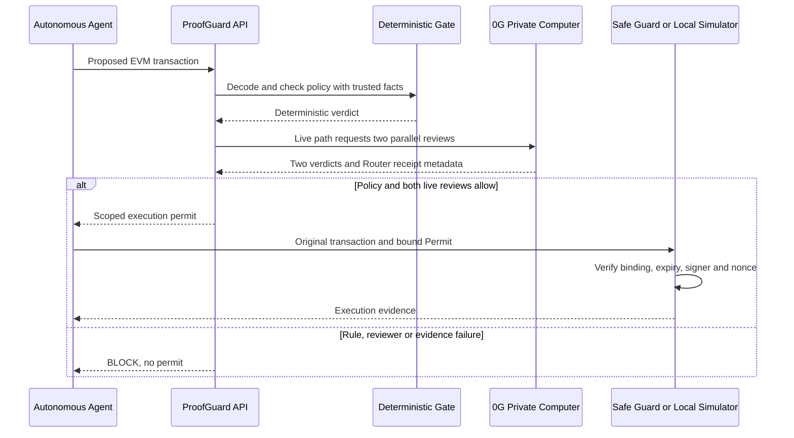

# ProofGuard 技术说明

## 1. 参赛信息

- 项目名称：ProofGuard
- 参赛赛道：赛道二 — Build with 0G Private Computer
- Sponsor：0G Labs
- 产品形态：Web App + Agent transaction firewall API
- 0G 模型委员会：`glm-5.3-flash` 主审 + `0GM-1.0-35B-A3B-SIA` 红队复核
- 推理模式：`private` / TeeML

## 2. 项目定义

ProofGuard 审查链上 Agent 提交的 EVM 交易。服务端解码原始 calldata，按独立取得的事实检查 Owner Policy。Base Sepolia 的实链提交由 Safe Guard 校验 Permit。实时模式的许可要求确定性规则与两次 0G 裁决全部放行，并且两次 Router 回执均确认 TEE 签名。

现有评测中，应当拦截的样本均由确定性规则覆盖，双模型没有产生新增的正确拦截。授权对照按范围只评估规则和 GoPlus 信号。模型对规则覆盖之外案例的增量尚未验证。[评测记录](../specs/002-project-completeness/tasks.md#evaluation-closure-and-limitations)

## 3. Sponsor 技术接入

### 3.1 0G Router

服务端调用 OpenAI 兼容端点：

```text
POST https://router-api.0g.ai/v1/chat/completions
Authorization: Bearer $ZERO_G_API_KEY
X-0G-Provider-Trust-Mode: private
```

默认主审为 `glm-5.3-flash`，默认红队复核为 `0GM-1.0-35B-A3B-SIA`。两次请求并行发出，请求携带 `verify_tee: true`，适配器校验模型、结束原因与裁决字段。任一请求失败、未完成、格式异常或 Router 未确认 TEE 签名，均不会发放许可。API key 不进入浏览器。

### 3.2 Private/TeeML 与回执

审查材料可能包括仓位、交易规模、目标合约和未广播的交易内容。实时集成配置为 Private/TeeML，记录 Router 报告的 TEE 验签结果。该回执用于核验推理来源。

### 3.3 证据处理

适配器保存：

- 每个 0G 审查节点的 response ID、Router request ID、provider、chat ID 和 Router TEE 验证结果
- 两个实际模型名称、角色与独立 verdict
- token usage 与 latency
- body 中的 `proof`、`attestation` 或 `verification`
- header 中所有 `x-0g-*`、`attestation`、`proof` 字段
- 模型原始响应的本地 SHA-256 commitment

只有响应的 `x_0g_trace.tee_verified === true` 表示 Router 报告其验证成功。通用响应头或 Proof 字段的存在本身不代表验证通过。独立验签另按 [0G 官方流程](https://docs.0g.ai/developer-hub/building-on-0g/compute-network/router/features/verifiable-execution) 复核。

## 4. 核心架构



### 4.1 前端

- React 19 + Vite
- 四个预置攻击场景
- Intercept → Private Inference → Policy → Seal 状态机
- 防火墙、证据室、架构三个页面
- EIP-712 钱包签名
- 篡改响应挑战与 fail-closed 可视化

### 4.2 后端

- Express 5
- 0G Router adapter
- 确定性策略引擎
- Permit 编译与 SQLite 审计、nonce 消费记录
- EIP-712 签名验证
- 静态生产构建托管

### 4.3 Permit 数据结构

```json
{
  "version": "proofguard-permit/2",
  "decision": "ALLOW",
  "owner": "0x...",
  "transactionHash": "0x...",
  "policyHash": "0x...",
  "inferenceHash": "0x...",
  "model": "glm-5.3-flash",
  "models": ["glm-5.3-flash", "0GM-1.0-35B-A3B-SIA"],
  "trustMode": "private",
  "issuedAt": "ISO-8601",
  "expiresAt": "ISO-8601",
  "nonce": "random-96-bit",
  "permitHash": "0x...",
  "scope": {
    "target": "0x...",
    "value": "0",
    "method": "execute(bytes,bytes[],uint256)",
    "chainId": 84532
  }
}
```

## 5. 关键功能

### 5.1 语义风险审查

实时主审与红队分别收到 Owner Mandate、解码后的交易效果和标记为不可信的 memo。生产审查提示词省略确定性结论。系统分别记录两份裁决和回执；任一裁决否决或证据不可用时，流程拒发 Permit。可见规则组和盲审组仅用于既有的内部评测。

### 5.2 确定性 Owner Policy

当前规则核对链、Agent 钱包、合约与资产白名单、收款地址、额度与授权、报价偏差与滑点、calldata 编码、已知注入模式，以及 Base Sepolia 的仓位纠偏 mandate。任何规则失败都会阻断 Permit，规则可独立否决。

### 5.3 三重 Commitment

- Transaction commitment：绑定实际将要执行的交易
- Policy commitment：证明 Owner Policy 没有在审查后被替换
- Inference commitment：证明展示与执行引用的是同一份模型响应

### 5.4 钱包与一次性 Permit

只有配置 `PROOFGUARD_OWNER_ADDRESS` 后才可消费许可。执行适配器从 EIP-712 签名恢复地址，与 Permit 绑定的策略钱包比对，并检查 Permit、有效期、原始提案和 nonce。成功后由 SQLite 原子更新消费记录。

## 6. 威胁模型

| 威胁 | 缓解措施 |
|---|---|
| Prompt Injection | 确定性模式检测，审查提示将 memo 标为不可信输入 |
| 模型错误放行 | 确定性规则独立执行，实时许可要求两份有效裁决；现有样本的正确拦截由规则完成 |
| 模型响应篡改 | inference commitment |
| 交易替换 | transaction commitment 与执行时复核 |
| Permit 重放 | 短有效期 + 随机 nonce + 一次消费 |
| 未授权访问与请求滥用 | Agent 审查和审计使用 Bearer 密钥并分别按密钥限流。公开模拟接口独立限流，浏览器跨域请求使用精确 Origin 白名单 |
| API key 泄露 | 0G 密钥留在服务端，Agent 密钥仅保存哈希 |
| 假冒 0G proof | 收据类型严格区分，不构造 Proof ID |
| 模型不可用或格式错误 | fail closed，不生成 Permit |

## 7. 错误处理

- 0G 单次请求超时为 90 秒。输出预算为 4,096 token，覆盖推理和最终 JSON；截断、超时或非 2xx 均不签发许可。
- 模型必须返回可解析 JSON；自然语言或缺字段响应不得变成 `ALLOW`。
- 模型裁决必须为 `ALLOW` 或 `BLOCK`，未知值会触发拒发。
- risk score 与 confidence 必须是范围内的有限数值。
- `/api/execute` 对未知、已用、过期、篡改或签名不匹配 Permit 返回 422。

## 8. 测试与验收

自动化测试覆盖：

- 合法交易通过
- 未知合约与非白名单资产阻断
- Prompt Injection 阻断
- 无限授权阻断
- 异常滑点阻断
- 确定性规则独立否决、实时双裁决准入和缺失回执拒发
- 对象稳定哈希
- 0G thinking tag 与 Markdown JSON 解析
- 非 JSON 模型响应失败关闭

验收命令：

```bash
npm test
npm run build
npm start
```

## 9. 当前 Demo 边界

- 无 0G API key 时使用确定性 Demo reviewer，页面明确标记为模拟，不宣称 TEE proof。
- 执行适配器会真实验证钱包签名和 Permit，但不会广播交易或移动资金。
- 浏览器预设使用固定市场样本。经过鉴权的 Base Sepolia 提案使用服务端配置的价格源，根据 calldata 和地址计算效果。
- Base Sepolia Agent 使用独立签发者签名、Safe Guard 与 RPC 余额模拟。测试网部署和长时间验收的状态以项目完整性规格记录为准。

这些边界保证演示可重复，同时不对未实现能力作虚假陈述。

## 10. 后续迭代计划

### Phase 1：可部署交易守卫

- Safe Module / ERC-7579 validator
- RPC state simulation 与资产差异解析
- PostgreSQL nonce registry 与审计日志
- 登录、限流和多租户策略管理

### Phase 2：语义审查评估

- 设计当前结构化规则没有覆盖的语义案例
- 评估新增正确拦截、误杀、成本、延迟和同错率
- 根据届时证据决定保留方式与权限

### Phase 3：链上可验证执行

- 官方 0G verifier 接口接入
- Permit Registry 合约
- TEE attestation 与交易哈希关联
- 跨链 Agent policy standard

### Phase 4：开发者生态

- LangGraph、ElizaOS、OpenAI Agents SDK 中间件
- REST/TypeScript SDK
- 恶意合约与污染工具情报网络
- DAO 与基金的 Policy Marketplace

